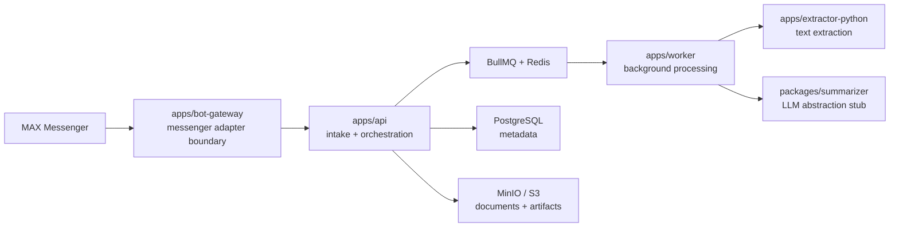

# Architecture

## Ключевая идея

`Messenger adapter` должен оставаться отдельным слоем. Всё, что связано с приёмом и отправкой сообщений в MAX, изолируется в `apps/bot-gateway` и `packages/integrations-max`. Основная обработка документа живёт отдельно в API, worker, extractor и summarizer слоях.

Это важно для white-label продажи: core pipeline можно переносить в другой messenger или web channel без переписывания extraction, queue, storage и summarization.

## Схема

## Слои

### 1. Messenger boundary

- `apps/bot-gateway`
- `packages/integrations-max`

Задача слоя: принимать updates, валидировать messenger-specific payloads, возвращать служебные ответы и отправлять готовый результат обратно в чат.

### 2. Core processing boundary

- `apps/api`
- `apps/worker`
- `packages/core`
- `packages/shared-types`
- `packages/summarizer`
- `packages/storage`

Задача слоя: intake, jobs, extraction orchestration, summarization contracts, persistence contracts и выдача статусов.

### 3. Specialized processing

- `apps/extractor-python`

Задача слоя: изолировать parsing и extraction из документов, не смешивая Python-инструменты с Node runtime.

## Что зафиксировано для следующих агентов

- вход во внешний messenger не должен тянуть за собой доменную логику;
- worker и extractor должны общаться через стабильные contracts;
- summary provider должен подменяться без изменения bot adapter;
- storage и queue — инфраструктурные зависимости, а не источник бизнес-логики.
